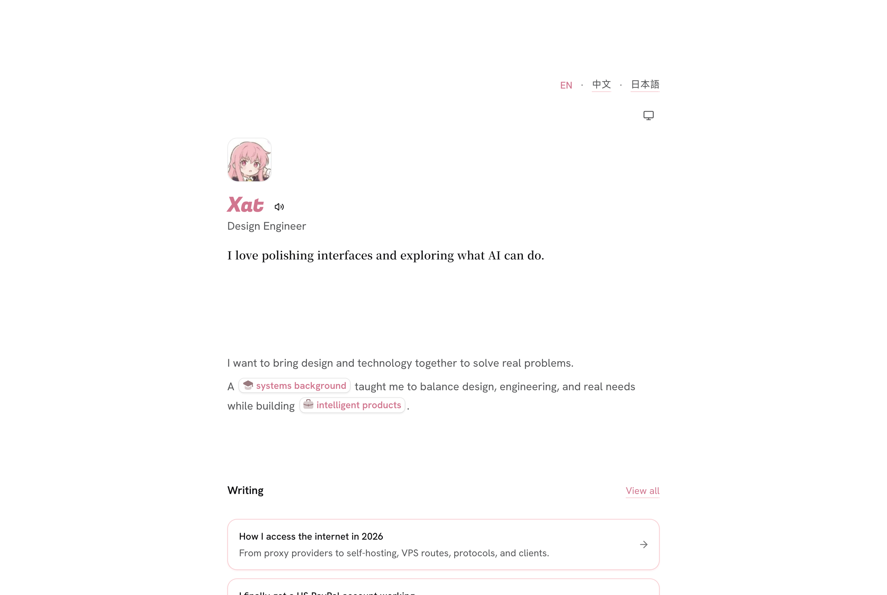

# ImI

🫧 My personal website and digital garden / 我的个人网站和数字花园 — [xat.sh](https://xat.sh)

<picture>
	<source media="(prefers-color-scheme: dark)" srcset=".github/assets/screenshot-dark.png">
	
</picture>

## Stack

- [Astro](https://astro.build) with SSR on Cloudflare Workers, edge-cached per locale
- MDX posts in `content/posts/{zh,en,ja}`, no CMS or database
- Tailwind CSS v4 and bejamas components
- Self-hosted, subset CJK fonts generated at build time
- A small SQLite-backed Durable Object for the footer view counter

## Development

```bash
pnpm install
pnpm dev
```

| Script | What it does |
| --- | --- |
| `pnpm dev` | Start the dev server |
| `pnpm build` | Sync emoji, render OG images, build for Workers |
| `pnpm lint` / `pnpm lint:fix` | ESLint |
| `pnpm typecheck` | `astro check` |
| `pnpm typegen` | Regenerate Worker binding types after editing `wrangler.jsonc` |

See [`AGENTS.md`](AGENTS.md), [`PRODUCT.md`](PRODUCT.md) and [`DESIGN.md`](DESIGN.md) for architecture, product and design notes.
