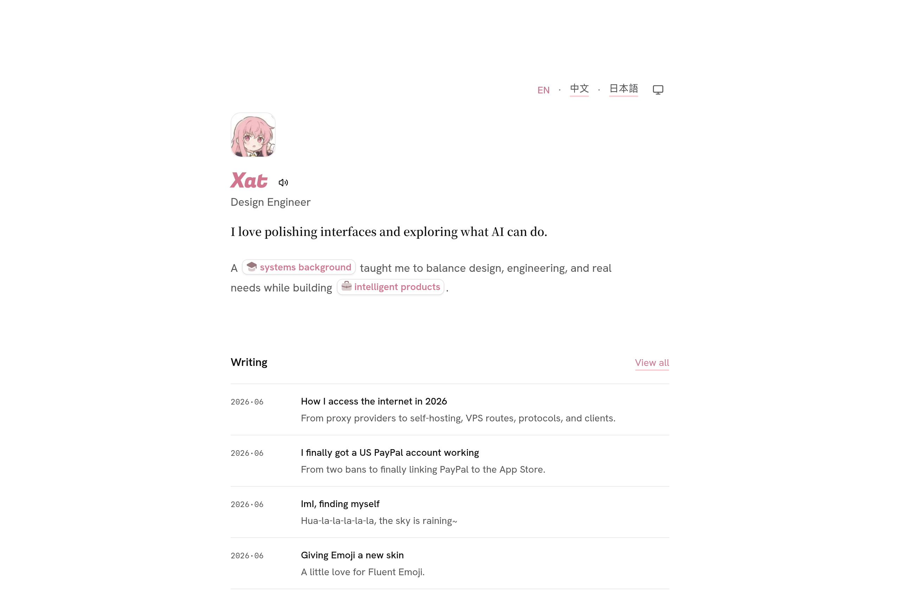

# ImI

🫧 My personal website and digital garden / 我的个人网站和数字花园 — [xat.sh](https://xat.sh)

<picture>
	<source media="(prefers-color-scheme: dark)" srcset=".github/assets/screenshot-dark.png">
	
</picture>

## Highlights

- **Prefix-free trilingual i18n** — `en`, `zh`, and `ja` on shared URLs (cookie + `Accept-Language`), with localized Satori OG cards and per-locale RSS feeds (`/feed.xml`, `/feed.en.xml`, `/feed.ja.xml`)
- **AI-native Markdown access** — `Accept: text/markdown` content negotiation on `/`, `/post`, `/post/[slug]`, and `/resume` (with `Vary: Accept` and `x-markdown-tokens`), plus `/llms.txt`, `/post.md`, `/post/[slug].md`, and `/resume.md`
- **Crafted CJK/Latin typography** — Hanken Grotesk paired with build-time subset MiSans instances tuned by hand, documented live from running CSS at [`/design`](https://xat.sh/design)
- **Reading & print polish** — Expressive Code, Fluent Emoji via [`rehype-fluent-emoji`](https://github.com/withxat/rehype-fluent-emoji), PhotoSwipe lightbox, section-outline scrollbar, keyboard shortcuts (`t`, `j`/`k`, `[`/`]`), and an A4 print layout at [`/resume`](https://xat.sh/resume)
- **Edge-native runtime** — Astro 7 SSR on Cloudflare Workers, edge-cached HTML per locale/country, a SQLite-backed Durable Object view & presence counter, intent-based font prefetch, and `Content-Security-Policy` headers

## Stack

- [Astro 7](https://astro.build) (SSR) on Cloudflare Workers (`@astrojs/cloudflare`)
- MDX posts in `content/posts/{zh,en,ja}` and YAML résumé in `content/resume/{en,zh,ja}.yaml` — no CMS or database
- Tailwind CSS v4, [bejamas](https://bejamas.io) UI primitives, and Motion
- Self-hosted variable & subset fonts (`vite-plugin-font`) + build-time Satori OG images
- Playwright E2E suite with full-page screenshot baselines in CI

## Development

```bash
pnpm install
pnpm dev
```

| Script | What it does |
| --- | --- |
| `pnpm dev` | Start the local dev server |
| `pnpm build` | Sync Fluent Emoji, generate trilingual OG images, and build for Workers |
| `pnpm og:generate` | Regenerate localized OG PNGs under `public/og/{en,zh,ja}/` |
| `pnpm lint` / `pnpm lint:fix` | Run ESLint |
| `pnpm typecheck` | Run `astro check` |
| `pnpm e2e:docker` | Run Playwright layout, error, contract, and screenshot checks in the CI image (pass `--update-snapshots` after an intended visual change) |
| `pnpm typegen` | Regenerate Worker binding types after editing `wrangler.jsonc` |

See [`AGENTS.md`](AGENTS.md), [`PRODUCT.md`](PRODUCT.md), and [`DESIGN.md`](DESIGN.md) for architecture, product, and design documentation.

## License

- Code: [MIT](LICENSE)
- Posts in `content/posts/`: [CC BY-NC 4.0](content/LICENSE)
- Third-party fonts and Fluent Emoji assets keep their own licenses.

## Author

**ImI** © [Xat](https://github.com/withxat), released under the [MIT](LICENSE) License.<br>
Authored and maintained by Xat with help from contributors ([list](https://github.com/withxat/ImI/graphs/contributors)).

> [Blog](https://xat.sh) · GitHub [@withxat](https://github.com/withxat) · Telegram [@withxat](https://t.me/withxat) · X [@withxat](https://x.com/withxat) · Email [i@xat.sh](mailto:i@xat.sh)
